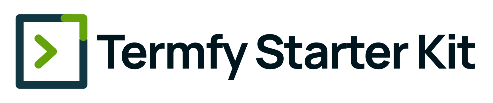

<p align="center">
  <a href="https://promovaweb.com/designfy/">
    <picture>
      <source media="(prefers-color-scheme: dark)" srcset="https://raw.githubusercontent.com/promovaweb/designfy/main/brand/logo/logo-dark.svg">
      
    </picture>
  </a>
</p>

<h1 align="center">Designfy</h1>

<p align="center">
  O framework visual que faz a interface de um projeto web sair desenhada, com
  design system, componentes React e Astro e revisão por captura.
</p>

<p align="center">Um projeto da <a href="https://promovaweb.com">Promovaweb</a></p>

<p align="center">
  <a href="https://github.com/promovaweb/designfy/releases/latest"></a>
  <a href="https://www.npmjs.com/package/@promovaweb/designfy"></a>
  <a href="https://github.com/promovaweb/designfy/blob/main/LICENSE"></a>
</p>

<p align="center">
  <a href="https://promovaweb.com/discord"></a>
</p>

<p align="center">
  <a href="https://promovaweb.com/designfy/">Site do projeto</a> ·
  <a href="https://promovaweb.com/docs/designfy/">Documentação</a> ·
  <a href="https://github.com/promovaweb/designfy/tree/main/docs/user">Guia do Usuário</a> ·
  <a href="https://promovaweb.com/harness/">Harness</a> ·
  <a href="https://promovaweb.com/ferramentas/">Ferramentas</a> ·
  <a href="https://promovaweb.com/discord">Discord</a> ·
  <a href="https://promovaweb.com/planos?utm_source=github&utm_medium=readme&utm_campaign=designfy">Planos da Promovaweb</a> ·
  <a href="https://github.com/promovaweb/designfy/blob/main/CHANGELOG.md">Changelog</a>
</p>

## O que é

Um site feito por agente costuma sair com a mesma cara: paleta improvisada,
tipografia padrão, um componente novo a cada página, nada se move e o celular
fica para depois. O Designfy entrega o método e as peças para quem constrói um
site em Astro ou um sistema em React com um agente de código: uma skill
orquestradora que entende o pedido, escreve a especificação da tela e aciona as
especialistas, um registro de componentes que leem o tema e uma revisão com
capturas em celular e desktop.

O mesmo executável atende a pessoa no terminal, os scripts de CI e o agente por
MCP.

| Entrega | O que você recebe |
| --- | --- |
| Skill orquestradora e especialistas | a skill `designfy` recebe o pedido e chama viewspec, design system, componentes, movimento, sites, conteúdo, web apps, responsivo, acessibilidade e revisão, dez especialistas no total |
| Viewspec | o guia `VIEWSPEC.md` na raiz do projeto e um viewspec por tela em `viewspec/<id>-<slug>/VIEWSPEC.md`, com nove seções e checklist por especialista |
| Catálogo de interface | 91 fragmentos comuns de site e de web app, com propósito, anatomia, variações, estados, acessibilidade, tokens e fonte de implementação |
| Registro de componentes | 69 itens React e 57 Astro sobre Tailwind 4, shadcn e Motion, copiados para o projeto com as dependências resolvidas |
| Tema e paleta | leitura do tema do Tailwind 4 e do Tailwind 3, contraste WCAG 2.2 e APCA, escala OKLCH e harmonias da roda de cores |
| Presets de fundo | 334 presets de fundo por tema, categoria e legibilidade, gerados a partir do tema |
| Capturas | Playwright em celular, tablet, desktop e tela larga, com a página inteira, os dois temas e um manifesto de estouro horizontal e erros de console |
| Integrações | reconhecimento do Astrofy e do Specsfy no `status` e no `doctor`, com o vínculo `trackedBy` no viewspec da tela |
| TUI | Home em menu e abas de tema, catálogo, componentes, skills, dependências, MCP, viewspecs e capturas |
| MCP | tools de projeto, skills, dependências, catálogo, componentes, tema, paleta, capturas e viewspecs para o agente |

A skill orquestradora é a porta de entrada do framework. Você descreve a tela,
ela lê o projeto e o guia, classifica o pedido, escolhe os fragmentos no
catálogo, monta o viewspec e passa cada parte para a especialista certa.

## Instalação

### Com o npm

```bash
npm i -g @promovaweb/designfy
designfy --version
```

O pacote é um invólucro fino: ele baixa o binário da release da mesma versão,
confere o SHA-256 e o guarda em `~/.designfy/bin/v<versão>/` para as próximas
execuções. Precisa de Node.js 18.17 ou superior.

### Pelo binário da release

Baixe o executável da sua plataforma em
[Releases](https://github.com/promovaweb/designfy/releases/latest):
`designfy-linux-x64`, `designfy-linux-arm64`, `designfy-darwin-x64`,
`designfy-darwin-arm64` ou `designfy-windows-x64.exe`. Confira o arquivo com o
`SHA256SUMS` da mesma release, dê permissão de execução e coloque no `PATH`.

### Instalar a skill no agente

A skill `designfy` ensina Claude Code, Codex, OpenCode e outros agentes a
especificar, compor e revisar a interface:

```bash
npx skills add promovaweb/designfy
```

Dentro de um projeto, o `designfy skills install` escolhe as skills compatíveis
com o framework detectado, instala as internas e as externas e grava o
`skills-lock.json`.

### Requisitos

- [Node.js](https://github.com/nodejs/node) 18.17 ou superior, para o pacote do
  npm, o `npx skills` e a captura, porque o Playwright roda num processo Node do
  projeto.
- [Bun](https://github.com/oven-sh/bun) 1.4.4 ou superior só para rodar o
  código-fonte ou compilar o binário. O executável da release já leva o runtime.
- Acesso ao GitHub, para o `npx skills add` buscar as skills.

Para capturar telas, o projeto precisa do Playwright e do Chromium:

```bash
designfy deps install testing
npx playwright install chromium
```

### Atualizar

```bash
npm i -g @promovaweb/designfy@latest
designfy --version
```

A versão nova baixa o binário dela na primeira execução e mantém o anterior em
cache. Pelo binário da release, baixe o arquivo novo e substitua o que está no
`PATH`. As notas de cada versão ficam no
[CHANGELOG](https://github.com/promovaweb/designfy/blob/main/CHANGELOG.md).

## Primeiros passos

Na raiz do site ou da aplicação:

```bash
designfy init
```

```text
Wrote /projeto/designfy.json (react-vite).
```

O `init` detecta o framework pelo `package.json`, o Tailwind, o `components.json`
do shadcn e o gerenciador pelo lockfile, e grava `designfy.json`. O
`--theme-path` aponta o CSS do tema quando a busca automática não encontra o
arquivo certo.

Confira o projeto:

```bash
designfy status
```

```text
  Framework             react-vite
  Detected framework    react-vite
  TypeScript            yes
  Package manager       bun
  Tailwind major        4
  shadcn                yes
  Skills installed      1
  Dependencies present  3
  Components copied     0
  Viewspecs             0
    draft               0
    in_progress         0
    blocked             0
    done                0
    archived            0
  Next viewspec ID      0001
  Viewspec guide        not found
  Tailwind theme        /projeto/src/styles/globals.css

Integrations

  astrofy  absent
  specsfy  absent  specsDir=specs
```

O bloco **Integrations** informa se o projeto usa o
[Astrofy](https://github.com/promovaweb/astrofy) ou o
[Specsfy](https://github.com/promovaweb/specsfy), com os caminhos encontrados.

Instale as dependências e as skills:

```bash
designfy deps install
designfy deps check
designfy skills install
```

Escreva a entrada do servidor MCP nos clientes do projeto:

```bash
designfy mcp setup
```

Por fim, chame a skill com o pedido da tela:

- "Use a skill designfy para criar a landing page de preços na rota `/precos`,
  com o conteúdo de `src/content/precos.md`."
- "Use a skill designfy para redesenhar o dashboard em `/app/vendas`, com
  quatro contadores, um gráfico de receita e a tabela dos pedidos recentes."
- "Use a skill designfy para montar o artigo `/blog/tailwind-4`, com índice,
  bloco de código e embed de vídeo, e revisar com captura no celular e no
  desktop."

## Uso

### Projeto

```bash
designfy init --framework astro --dry-run   # mostra o designfy.json sem gravar
designfy init --force                        # substitui um arquivo existente
designfy init --theme-path src/styles/tokens.css
designfy status --json
```

O `designfy.json` guarda o framework, o TypeScript, o gerenciador, a versão do
Tailwind, o shadcn e os caminhos de componentes, estilos, tema e viewspec.
Quando o arquivo existe, os campos definidos nele prevalecem sobre a detecção.

A option global `--project` (`-C`) executa qualquer command com a raiz
indicada, sem trocar de pasta:

```bash
designfy -C ./website status
designfy --project ../app capture run http://localhost:4321/ --viewport mobile
```

A variável `DESIGNFY_PROJECT` define o padrão quando a option não aparece.

### Skills

```bash
designfy skills list
```

```text
  designfy                Designfy (internal, no)
  designfy-viewspec       Viewspec (internal, no)
  designfy-design-system  Design system (internal, no)
  designfy-components     Components (internal, no)
  designfy-motion         Motion (internal, no)
  designfy-websites       Websites (internal, no)
  designfy-content        Content (internal, no)
  designfy-webapps        Web apps (internal, no)
  designfy-responsive     Responsive (internal, no)
  designfy-accessibility  Accessibility (internal, no)
  designfy-review         Review (internal, no)
  hallmark                Hallmark (external, global)
  shadcn                  shadcn/ui (external, no)
  migrate-radix-to-base   Radix to Base UI (external, no)
  astrofy                 Astrofy (external, no)
  specsfy                 Specsfy (external, no)
  brandfy                 Brandfy (external, no)
```

```bash
designfy skills install --all
designfy skills install designfy-review --agent codex
designfy skills update
designfy skills remove designfy-content
```

O estado de cada skill é `project`, `global` ou `no`. As internas vêm de
`promovaweb/designfy`; as externas, do Hallmark, do shadcn/ui, do Astrofy, do
Specsfy e do Brandfy.

### Catálogo e componentes

```bash
designfy catalog list --surface webapp
designfy catalog show button
designfy catalog search "empty state"
```

```text
  button              Button (both, actions)
  link                Text link (both, actions)
  card                Card (both, containers)
  badge               Badge (both, data-display)
  avatar              Avatar (both, data-display)
```

O catálogo é a fonte que as skills leem para escolher os fragmentos de uma tela,
antes de olhar para qualquer implementação. A superfície é `site`, `webapp` ou
`both`; o valor antigo `system` continua aceito e é lido como `webapp`.

```bash
designfy components list --surface webapp
designfy components show cn
designfy components add cn --framework react --dry-run
```

```text
  Would write           /projeto/src/components/designfy/lib/cn.ts
  Unchanged             None
  Skipped               None
  Missing npm packages  clsx, tailwind-merge
  Missing dev packages  None
  Install shadcn items  None
```

O `components add` copia o item e os itens exigidos, troca o marcador
`@designfy/components` pelo alias do projeto e relata os pacotes npm e os itens
`shadcn:` que faltam. Arquivo existente e diferente não é tocado sem
`--overwrite`. Num projeto em Tailwind 3, o comando recusa com exit code 10 e o
`--allow-tailwind3` copia com aviso.

### Tema e paleta

```bash
designfy theme show --group colors
```

```text
  --color-background          light oklch(1 0 0) → #ffffff | dark oklch(0.16 0.02 220) → #040f13
  --color-foreground          light oklch(0.2 0.02 220) → #0b181c | dark oklch(0.96 0.01 220) → #ebf3f6
  --color-primary             light oklch(0.62 0.12 190) → #009a94 | dark oklch(0.78 0.12 190) → #3ed0c8
  --color-muted-foreground    light oklch(0.45 0.02 220) → #49585d | dark oklch(0.45 0.02 220) → #49585d
```

```bash
designfy theme check
designfy palette wheel "#2AD5BE"
designfy palette generate --base "#2AD5BE" --harmony triadic --format css --out src/styles/tokens.css
designfy palette contrast "#00161E" "#C6F4ED"
```

```text
  Foreground    #00161e
  Background    #c6f4ed
  WCAG ratio    15.50:1
  APCA          Lc 93.0
  Normal text   AA pass, AAA pass
  Large text    AA pass, AAA pass
  UI component  AA pass, AAA N/A
```

O `theme show` e o `theme check` leem, nesta ordem, o `--file`, o `paths.theme`
do `designfy.json`, o `tokensFile` do `VIEWSPEC.md` e a busca do CSS do
Tailwind. Um projeto em Tailwind 3 também é lido, com o `tailwind.config.*`
completando os tokens.

O `theme check` mede os pares de cor do tema nos dois modos e confere os papéis
que o registro usa. Par abaixo de 4.5 ou papel obrigatório ausente sai com exit
code 10. Num projeto com escalas próprias, o modo `custom` mede os pares de
`theme.pairs`:

```json
{
  "theme": {
    "pairs": [
      { "fg": "--text-body", "bg": "--bg-page", "label": "Texto corrido" },
      { "fg": "primary-950", "bg": "white", "label": "Destaque", "min": 7 }
    ]
  }
}
```

### Viewspec

```bash
designfy viewspec guide
designfy viewspec list
designfy viewspec progress
designfy viewspec validate
```

```text
  0002  Dashboard de vendas  |  dashboard  |  in_progress  |  1/6
```

```text
  draft        0
  in_progress  1
  blocked      0
  done         0
  archived     0
  Checklist    1/6
  Next id      0001
```

O guia da raiz vale para todas as telas. Cada viewspec de tela guarda objetivo,
conteúdo, estrutura, estados, responsivo, movimento, acessibilidade, checklist e
notas. O binário lê e valida; quem escreve é a skill `designfy-viewspec`.

O campo `trackedBy` liga o viewspec ao registro da tarefa no Astrofy ou no
Specsfy, e o `viewspec validate` confere o arquivo de cada vínculo:

```yaml
trackedBy:
  - system: specsfy
    id: "0007"
    path: specs/planned/0007-cadastro-de-clientes/spec.md
```

### Capturas

```bash
designfy capture run http://localhost:4321/ --viewport mobile,desktop
```

```text
  Run        demo
  Directory  /projeto/.designfy/captures/demo
  mobile     localhost-4321--mobile.png
  desktop    localhost-4321--desktop.png
```

Antes do print da página inteira, o navegador rola em passos da altura da
viewport, espera a rede, as imagens e as fontes e volta ao topo. Os overlays de
desenvolvimento de Astro, Vite e Next.js ficam ocultos. `--hide` esconde outros
seletores, `--scroll-budget` limita a preparação, `--no-scroll` pula a rolagem e
`--theme light,dark` grava um PNG por viewport em cada tema.

O `manifest.json` registra, por captura, o título, as medidas da página, o tema,
os passos da rolagem, as imagens incompletas, o orçamento esgotado, os erros de
console e `overflowX`, o sinal de conteúdo mais largo que a viewport. Viewports
nomeados: `mobile` 390x844, `tablet` 820x1180, `desktop` 1440x900 e `wide`
1920x1080; `LARGURAxALTURA` aceita outra dimensão. Use `--reduced-motion`,
`--fold` e `--selector` para recortar a revisão.

```bash
designfy capture list
```

```text
  demo  2 screenshots (/projeto/.designfy/captures/demo)
```

### TUI

`designfy` sem argumentos abre a Home em menu, com um próximo passo para o
estado do projeto e um cartão por módulo. O quadro abaixo é o de referência,
com a paleta `night`.

```text
    › Install dependencies   [Enter]

   ╭─ 1 ◐ Theme ─────────────────────────────╮  ╭─ 2 ≡ Catalog ────────────────────────────╮  ╭─ 3 λ Components ────────────────────────╮
   │ globals.css                             │  │ 91 patterns                              │  │ Registry · react-vite                   │
   │ ██ ██ ░░ ░░ ░░ ░░ ░░                    │  │ site   ━━━━━━━━━━━━ 43                   │  │ Copied ━━━━━━━━ 0/69 0%                 │
   │ ✓ 18.88:1 FG / BG                       │  │ webapp ━━━━━━       22                   │  │                                         │
   │ Inter, sans-serif                       │  │ both   ━━━━━━━      26                   │  │                                         │
   ╰─────────────────────────────────────────╯  ╰──────────────────────────────────────────╯  ╰─────────────────────────────────────────╯

    Enter  open   r  reload  │   T  theme   ^K  commands   ?  help   q  quit
```

Use `1` a `9` e `0` para abrir um módulo de qualquer lugar, `T` para alternar
entre as paletas `terminal`, `night` e `day`, e `Ctrl+K` para a paleta de
comandos. Abra uma aba direto com `designfy tui --tab theme`. As listas de
skills, dependências e MCP têm seleção múltipla: `space` marca, `a` marca todas,
`n` limpa e `i` instala as marcadas.

## Uso com agentes

### Skills

As skills são arquivos de instrução que o agente lê. A `designfy` recebe o
pedido e chama as especialistas na ordem do viewspec. O comando abaixo instala
as internas e as externas compatíveis:

```bash
designfy skills install --agent claude-code,codex,opencode
```

Cada especialista cobre uma área: viewspec, design system, componentes,
movimento, sites, conteúdo, web apps, responsivo, acessibilidade e revisão. Os
estudos de páginas reais e de telas de sistema ficam em
`skills/designfy-websites/references/estudos/` e
`skills/designfy-webapps/references/estudos/`.

### MCP

```bash
designfy mcp
```

```json
{ "mcpServers": { "designfy": { "command": "designfy", "args": ["mcp"] } } }
```

O `mcp setup` grava essa entrada nos arquivos de projeto de Claude Code, Codex,
OpenCode, Cursor e Gemini CLI. Para desenvolvimento, sem compilar, use
`"command": "bun", "args": ["run", "src/main.ts", "mcp"]`.

| Grupo | Tools |
| --- | --- |
| Projeto | `project_status`, `doctor`, `about` |
| Skills | `skills_list` |
| Dependências | `deps_list`, `deps_check` |
| Catálogo | `catalog_list`, `catalog_show`, `catalog_search` |
| Componentes | `components_list`, `components_show`, `components_add` |
| Tema e paleta | `theme_show`, `theme_check`, `palette_generate`, `palette_wheel`, `palette_contrast` |
| Viewspec | `viewspec_guide`, `viewspec_list`, `viewspec_show`, `viewspec_progress`, `viewspec_validate` |
| Capturas | `capture_run`, `capture_list` |
| Servidores e configuração | `mcp_servers`, `skill`, `config_list`, `config_get`, `credentials_status`, `exit_codes` |

As tools de projeto usam a pasta de trabalho do servidor, escolhida por
`designfy mcp --project ./website`, por `DESIGNFY_PROJECT` ou pelo argumento
`project` de cada chamada. O cofre expõe pelo MCP apenas metadados.

Para um agente que só consulta, inicie sem as tools que escrevem:

```bash
designfy mcp --read-only
```

O modo de leitura retira `components_add` e `capture_run`. Todas as outras tools
continuam disponíveis. Veja a superfície sem iniciar o servidor com
`designfy mcp --list`.

## Saída para scripts

Com `--json`, toda resposta segue o envelope `{ ok, command, data }` ou
`{ ok, command, error }`.

```json
{
  "ok": true,
  "command": "designfy status",
  "data": {
    "detected": {
      "framework": "react-vite",
      "typescript": true,
      "packageManager": "bun",
      "tailwind": 4,
      "shadcn": true
    }
  }
}
```

```json
{
  "ok": false,
  "command": "designfy viewspec guide",
  "error": {
    "code": 6,
    "name": "NOT_FOUND",
    "message": "Project guide VIEWSPEC.md is missing from the project root.",
    "details": { "file": "/projeto/VIEWSPEC.md" }
  }
}
```

O exit code do processo é o mesmo de `error.code`. Algumas conferências entregam
dados com exit code diferente de zero: confira `data.ok` no `doctor`,
`data.valid` no `viewspec validate` e `data.errors` nas consultas de viewspecs.

| Code | Name | Quando |
| --- | --- | --- |
| 0 | `SUCCESS` | operação concluída |
| 1 | `GENERIC_ERROR` | falha inesperada sem classificação |
| 2 | `USAGE` | arguments, options ou subcommand inválidos; binário sem argumentos fora de um TTY |
| 3 | `CONFIG` | settings.json ausente, inválido ou key desconhecida |
| 4 | `CREDENTIALS` | credentials.json ilegível, master key ausente ou credencial não encontrada |
| 5 | `NETWORK_OR_API` | falha de rede, resposta de API fora do esperado ou processo externo que falhou |
| 6 | `NOT_FOUND` | recurso, componente, arquivo ou guia inexistente |
| 7 | `PERMISSION` | permissão negada no sistema de arquivos |
| 8 | `NO_TTY` | a TUI exige um terminal interativo |
| 9 | `MCP` | o servidor MCP falhou ao iniciar ou perdeu o transporte |
| 10 | `CHECK_FAILED` | conferência reprovada, como dependência ausente, contraste insuficiente ou viewspec inválido |
| 130 | `INTERRUPTED` | entrada cancelada ou processo interrompido com Ctrl+C |

## Arquivos e segurança

| Caminho | Conteúdo |
| --- | --- |
| `designfy.json` | projeto detectado, framework, gerenciador, Tailwind, shadcn e caminhos |
| `VIEWSPEC.md` | guia de interface do projeto, com regras e aprendizados |
| `viewspec/<id>-<slug>/VIEWSPEC.md` | especificação e checklist de uma tela |
| `.designfy/captures/<run>/` | capturas e `manifest.json` de cada execução |
| `~/.designfy/settings.json` | preferências, em texto claro, com permissão 0600 |
| `~/.designfy/credentials.json` | cofre cifrado com AES-256-GCM, com permissão 0600 |
| `~/.designfy/master.key` | master key em hexadecimal, com permissão 0600 |
| `~/.designfy/bin/` | binário do npm baixado da release e mantido em cache |

A pasta `~/.designfy/` nasce com 0700. O binário não guarda segredo próprio: o
cofre vem do starter kit e fica para as credenciais que você cadastrar. A master
key vem de `DESIGNFY_MASTER_KEY` quando a variável existe e, sem ela, de
`master.key`. Para um nível acima, injete a chave por variável a partir de um
gerenciador de segredos e não grave `master.key` em disco.

O `designfy doctor` confere o ambiente sem gravar arquivo e sem mostrar
segredos:

```text
✓ bun: 1.4.4; minimum 1.4.4
✓ node: /usr/bin/node
✓ npx: /home/usuario/.npm-global/bin/npx
✓ designfy.json: Project file exists
! VIEWSPEC.md: Not created
✓ tailwind-theme: /projeto/src/styles/globals.css
```

`✓` aprova, `!` avisa e `✗` reprova o comando com exit code 3.

## Migração

A versão 0.1.5 renomeou dois valores. Nenhum deles quebra o projeto existente:

- A skill `designfy-systems` passou a se chamar `designfy-webapps`. Rode
  `designfy skills install` para instalar o nome novo e remova o antigo com
  `designfy skills remove designfy-systems`.
- A superfície `system` passou a se chamar `webapp`. O valor antigo continua
  aceito no `--surface`, no viewspec e nas tools do MCP, e é lido como `webapp`.

O histórico completo está no [CHANGELOG.md](https://github.com/promovaweb/designfy/blob/main/CHANGELOG.md).

## Documentação

- [Guia do Usuário](https://github.com/promovaweb/designfy/tree/main/docs/user),
  com onze capítulos: introdução e instalação, preparar o projeto, skills,
  viewspec, tema e paleta, catálogo e componentes, fundos e movimento, capturas
  e revisão, TUI, agentes e MCP, e referência. Também em
  [PDF](https://github.com/promovaweb/designfy/blob/main/ebook/Designfy-Guia-do-Usuario-v0.2.0.pdf)
  e [EPUB](https://github.com/promovaweb/designfy/blob/main/ebook/Designfy-Guia-do-Usuario-v0.2.0.epub).
- [Documentação no site](https://promovaweb.com/docs/designfy/), publicada a
  cada versão.
- [Documentação técnica](https://github.com/promovaweb/designfy/blob/main/docs/README.md): [CLI](https://github.com/promovaweb/designfy/blob/main/docs/cli.md), [TUI](https://github.com/promovaweb/designfy/blob/main/docs/tui.md),
  [MCP](https://github.com/promovaweb/designfy/blob/main/docs/mcp.md), [configuração](https://github.com/promovaweb/designfy/blob/main/docs/configuration.md),
  [exit codes](https://github.com/promovaweb/designfy/blob/main/docs/exit-codes.md), [arquitetura](https://github.com/promovaweb/designfy/blob/main/docs/architecture.md) e o
  [contrato do viewspec](https://github.com/promovaweb/designfy/blob/main/docs/viewspec.md).
- Referência embutida: `designfy --skill` imprime a documentação inteira;
  `designfy --skill cli` imprime só uma seção, com a referência gerada do
  registry.
- Ajuda de cada comando: `designfy <command> --help`.

## Feito com

| Projeto | Para quê |
| --- | --- |
| [Bun](https://github.com/oven-sh/bun) | runtime, bundler e compilação do binário |
| [Node.js](https://github.com/nodejs/node) | execução do pacote do npm, das skills e do Playwright da captura |
| [Termfy](https://github.com/promovaweb/termfy) | framework de CLI, TUI e MCP que originou o binário |
| [Astrofy](https://github.com/promovaweb/astrofy) | sites Astro, com a sitespec que conversa com o viewspec |
| [Specsfy](https://github.com/promovaweb/specsfy) | especificação de fatia, com a spec que o viewspec acompanha |
| [Brandfy](https://github.com/promovaweb/brandfy) | marca, símbolo e manual que alimentam o design system |
| [Tailwind CSS](https://github.com/tailwindlabs/tailwindcss) | tema, tokens e utilitários dos componentes |
| [shadcn/ui](https://github.com/shadcn-ui/ui) | componentes, primitives e formato do registro |
| [ReUI](https://github.com/keenthemes/reui) | componentes e padrões que entram pelo registro do shadcn |
| [Motion](https://github.com/motiondivision/motion) | movimento dos componentes e das telas |
| [Playwright](https://github.com/microsoft/playwright) | capturas em celular, tablet e desktop |
| [Hallmark](https://github.com/nutlope/hallmark) | revisão de página gerada e lista de acabamento |
| [Astro](https://github.com/withastro/astro) | sites que recebem os componentes Astro |
| [React](https://github.com/facebook/react) | sistemas e ilhas que recebem os componentes React |
| [TanStack Table](https://github.com/TanStack/table) | tabelas de dados do catálogo |
| [Recharts](https://github.com/recharts/recharts) | gráficos de dashboard |
| [OpenTUI](https://github.com/sst/opentui) | interface do terminal |

## Comunidade e suporte

- **Discord:** [obter ajuda e conversar com a Comunidade](https://promovaweb.com/discord).
- **Bugs e pedidos:** abra uma [issue](https://github.com/promovaweb/designfy/issues)
  com a versão, o sistema operacional e o passo a passo para reproduzir.
- **Novidades:** acompanhe o [CHANGELOG](https://github.com/promovaweb/designfy/blob/main/CHANGELOG.md)
  e as [releases](https://github.com/promovaweb/designfy/releases).

## Contribuir

Este README cobre o uso. Para ambiente de desenvolvimento, organização do
código, validação, skills, registro de componentes e releases, leia o
[CONTRIBUTING.md](https://github.com/promovaweb/designfy/blob/main/CONTRIBUTING.md).

## Promovaweb

O Designfy é mantido pela [Promovaweb](https://promovaweb.com), comunidade de
co-working digital onde profissionais aprendem a construir, automatizar e gerir
negócios de tecnologia e IA com aulas ao vivo, Co-works e revisão de projetos
reais.

Quer usar o Designfy em projetos de verdade, com acompanhamento? Conheça os
[planos da Promovaweb](https://promovaweb.com/planos?utm_source=github&utm_medium=readme&utm_campaign=designfy).

## Licença

Distribuído sob a [GNU AGPL 3.0](https://github.com/promovaweb/designfy/blob/main/LICENSE). A licença não concede o uso do nome e
do logo do Designfy nem da marca Promovaweb (AGPL 3.0, seção 7, item e).
